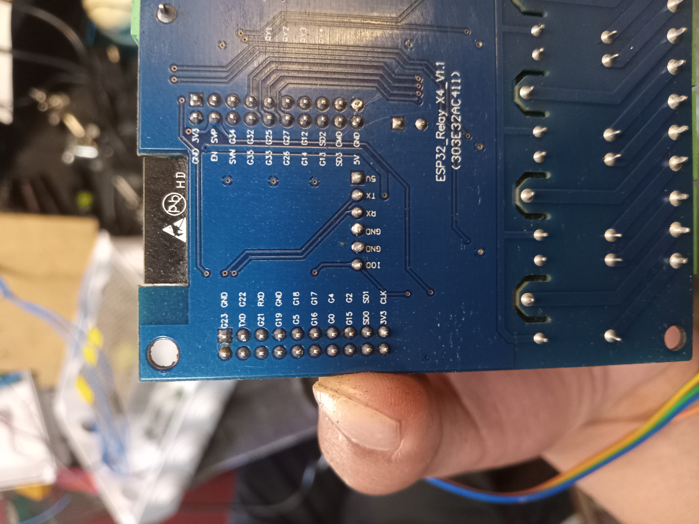
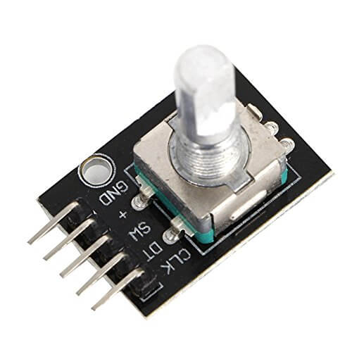
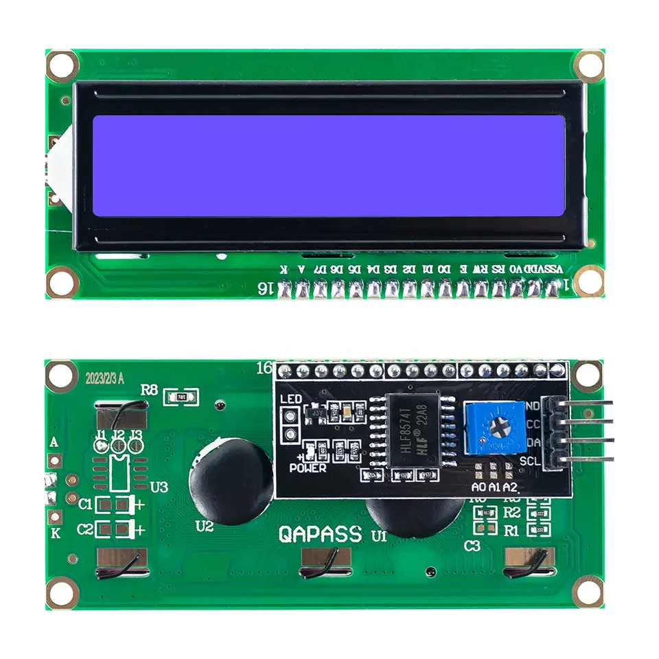

# SISTEMA DE CONTROL PARA EL EQUIPO DE PRUEBAS DE PENETRACIÓN EN MUROS
## Pines en la placa de control
La rotulación de los pines de la placa de control se encuentra en la cara posterior de la misma.



## Definición de los pines
### Pines para el Encoder Rotatorio
El encoder rotatorio utilizado para la manipulación y selección de estados se muestra en la siguiente imagen.



Los pines utilizados se describien en la siguiente tabla:
| Encoder | Placa de Control |
|:---:|:---:|
| CLK | 4 |
| DT | 16 |
| SW | 17 |
| VCC | 3.3V |
| GND | GND |

### Pines para la pantalla LCD I2C 16x02
La pantalla LCD se muestra en la siguiente imagen.



Los pines utilizados para la conexión en la pantalla se describen en la tabla:
| LCD | Placa de Control |
|:---:|:---:|
| SCL | 22 |
| SDA | 21 |
| VCC | 5V |
| GND | GND |

### Pines generales para la entrada y salida digital
- Los pines de salida se describen en la siguiente tabla:

| Actuador | Placa de Control |
|:---------:|:---------:|
| Luz Piloto VERDE | 25 |
| Luz Piloto ROJO | 26 |
| Bomba de Agua	| 32 |
| Ventilador | 33 |
| Buzzer Alerta| 18 |

- Los pines de entrada se describen en la siguiente tabla:

| Sensor | Placa de Control |
|:---:|:---:|
| Nivel de Agua | 14 |
| Caudalimetro | 5 |

- Para el **caudalimetro** se tienen las siguientes parametros importantes (pulsos por volumen).

En la tabla se establecen los valores por defecto.

| Volumen [L] | Pulsos [Raising] |
|:---:|:---:|
| 1.0 | 75 |

> [!PRECAUCIÓN]
> No es recomendable hacer cambios en las otras constantes simbólicas `#define`.

## Compilación de Código y Cargado 
### Utilizando _justfile_
Si no se tiene instalado _justfile_, el mismo se puede instalar desde los repositorios de **Rust** mediante **Cargo**.

```bash
cargo install justfile
```

Para la compilación rápida se recomienta utilizar **just**, el cual hace una abreviación de comandos extensos en _bash_. En la tabla se muestran los comandos _just_ establecidos.

| Comando Just | Función |
|:---:|:---|
| `just b` | Compilación de código |
| `just u` | Cargar binario a la placa ESP32 |
| `just m` | Abrir monitor serial en la terminal|

### Utilizando _arduino-cli_
Es la forma más tediosa, pero la ventaja es que no se necesita _just_. Se establecen los siguientes comandos:

- Compilación del código.

```bash
arduino-cli compile \
  --fqbn "esp32:esp32:esp32" \
  --board-options "FlashSize=4M" \
  --board-options "PartitionScheme=default" \
  --board-options "CPUFreq=240" \
  -v "iem-caudal-simple.ino"
```

- Cargar binario a la placa ESP32

```bash
arduino-cli upload \
  --port "/dev/ttyUSB0" \
  --fqbn "esp32:esp32:esp32" \
  --board-options "UploadSpeed=921600" \
  -v "iem-caudal-simple.ino"
```

- Abrir monitor serial

```bash
arduino-cli monitor \
  --config baudrate=115200 \
  --port "/dev/ttyUSB0" \
  --fqbn "esp32:esp32:esp32" \
  "iem-caudal-simple.ino"
```


